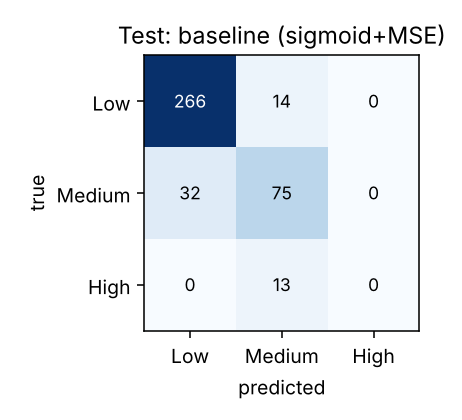
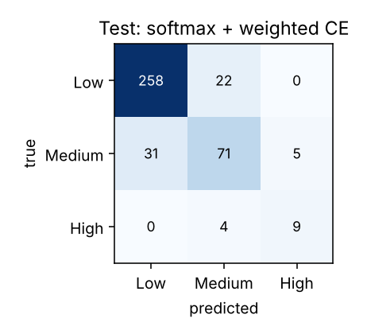

# Gaming Addiction Prediction

Machine-learning models implemented **from scratch in NumPy** (no scikit-learn, no PyTorch) to predict, from a gaming & mental-health dataset:

- **Classification** — a player's addiction level (Low / Medium / High)
- **Regression** — a player's addiction score (0–10)

The project has two parts: classic models (KNN, logistic and linear regression), then a **Multi-Layer Perceptron with hand-written backpropagation** and a **K-Means classifier**, with a focus on **class imbalance**.

## Models

| Model | Task | Implementation |
|---|---|---|
| k-Nearest Neighbors | classification & regression | vectorized Euclidean distances, majority vote / mean of the k neighbors |
| Logistic Regression | classification | multi-class softmax, cross-entropy, batch gradient descent |
| Linear Regression | regression | closed-form least squares with bias term |
| Multi-Layer Perceptron | classification & regression | forward pass, backpropagation (chain rule) and mini-batch SGD written by hand; Sigmoid / ReLU / Identity / Softmax activations; MSE, cross-entropy and MAE losses |
| Weighted cross-entropy | classification | softmax output with inverse-frequency class weights to recover the rare class |
| K-Means classifier | classification | Lloyd's algorithm, clusters labelled by majority vote, prediction by nearest centre |

## Pipeline

1. **Standardization** fitted on the training split only (no data leakage); constant features guarded.
2. **Validation split** (80/20) for model selection; the test set is used once, for the final comparison.
3. **Hyperparameter search** — K for KNN and K-Means; learning rate and iterations for logistic regression; hidden size and learning rate for the MLP.
4. **5-fold cross-validation** of the selected MLP to check that the validation estimate is stable.
5. **Evaluation** — accuracy, macro-F1, per-class recall and confusion matrices (classification), MSE (regression), plus training and inference time.

## Results (test set)

**Classification**

| Model | Accuracy | Macro-F1 |
|---|---|---|
| KNN (K = 3) | 76.5 % | 0.552 |
| K-Means classifier (K = 100) | 78.3 % | 0.585 |
| Logistic Regression | 85.8 % | 0.597 |
| MLP (sigmoid + MSE) | 85.3 % | 0.546 |
| **MLP (softmax + weighted cross-entropy)** | **84.5 %** | **0.757** |

**Regression**

| Model | MSE |
|---|---|
| KNN (K = 11) | 1.880 |
| MLP (hidden = 16) | 1.037 |
| **Linear Regression** | **0.994** |

**Takeaways**

- The data is heavily imbalanced (only ~3 % "High"). A plain MLP reaches 85 % accuracy but **never predicts the rare class** (recall 0.00).
- An **inverse-frequency weighted cross-entropy** lifts rare-class recall from **0 to 0.69** and macro-F1 from **0.55 to 0.76**, for a 0.75-point accuracy drop.
- 5-fold cross-validation gives 84.2 ± 0.7 % accuracy: the held-out estimate is reliable.
- For regression, the MLP does not beat linear regression: the score is essentially linear in the features.

| Baseline MLP | Weighted cross-entropy |
|---|---|
|  |  |

## Usage

```bash
pip install -r requirements.txt

# Part 1 — KNN, logistic and linear regression
python main.py --task classification --method logistic_regression --lr 0.05 --max_iters 1000 --test
python main.py --task regression --method linear_regression --test

# Part 2 — MLP and K-Means
python main_nn.py --task classification --method mlp --weighted --hidden_nodes 64 --lr 0.01 --max_iters 80 --test
python main_nn.py --task classification --method kmeans --K 100 --test

# Hyperparameter sweeps, cross-validation and figures
python experiments.py
```

The dataset is expected at `data/features.npz` with keys `xtrain`, `xtest`, `ytrainreg`, `ytestreg`, `ytrainclassif`, `ytestclassif`.

## Project structure

```text
main.py                     # CLI for KNN, logistic and linear regression
main_nn.py                  # CLI for the MLP and the K-Means classifier
experiments.py              # sweeps, 5-fold CV, confusion matrices and figures
src/utils.py                # one-hot encoding, normalization, accuracy, macro-F1, MSE
src/activations.py          # Sigmoid, ReLU, Identity, Softmax
src/losses.py               # MSE, MAE, cross-entropy, weighted cross-entropy
src/methods/                # knn, logistic_regression, linear_regression, mlp, kmeans
figures/                    # confusion matrices, loss curve, K-Means sweep
```

## Credits

Built with two teammates.
